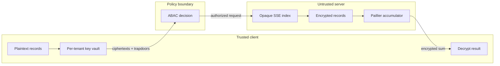

# Multi-Tenant Zero-Knowledge Cloud Engine

A runnable educational cloud-security system in which an honest-but-curious server performs exact-token search and integer summation over encrypted tenant data. The server receives no AES/search secret keys, Paillier private keys, plaintext documents, numeric values, or plaintext query terms.

> **Terminology:** "zero-knowledge" describes the project's application-level privacy goal. This implementation is not a formal zero-knowledge proof protocol. See [Threat model and limitations](#threat-model-and-limitations).

## Live demo features

- Isolated cryptographic keys and encrypted indexes for two sample tenants.
- AES-256-CBC document encryption with PKCS#7 padding and encrypt-then-MAC integrity.
- HMAC-SHA256 exact-token trapdoors generated only after ABAC authorization.
- Paillier encrypted integer sums computed as ciphertext multiplication modulo `n²`.
- Split-screen Streamlit UI with trusted-client controls and sanitized server logs.
- Deny-by-default ABAC checks for tenant, role, department, clearance, and UTC session hour.
- A client-side record form and one-click sample-data bootstrap.

## Architecture



The demo maintains the separation inside one Streamlit process so it is easy to run. `ClientVault` objects live only in `st.session_state.vaults`; simulated server state lives under `st.session_state.server` and contains only public keys, ciphertexts, opaque index tokens, document identifiers, and explicit policy metadata.

## Cryptographic design

### Authenticated AES-CBC documents

The synopsis requires AES-CBC. Because unauthenticated CBC is malleable, `AESCBCCipher` derives two independent 256-bit subkeys from a random tenant master key using HKDF-SHA256. It encrypts UTF-8 text with a fresh 128-bit IV and PKCS#7 padding, then authenticates the version, tenant ID, IV, and ciphertext with HMAC-SHA256. Decryption verifies the MAC in constant time before invoking AES.

For new real-world designs, prefer a vetted AEAD construction such as AES-GCM or ChaCha20-Poly1305. CBC is retained here to satisfy the lab specification.

### Blind searchable encryption

The trusted client normalizes a single token and computes:

```text
trapdoor = HMAC-SHA256(search_key, domain || tenant_id || normalized_term)
```

During indexing, only these trapdoors and document IDs are sent to the server. During search, the server performs a dictionary lookup using the received 256-bit token. Domain and tenant binding prevent accidental cross-protocol or cross-tenant token reuse.

### Paillier homomorphic sum

For Paillier public key `(n, g)`, multiplying two ciphertexts produces an encryption of the plaintext sum:

```text
E(m1) × E(m2) mod n² = E(m1 + m2 mod n)
```

`HomomorphicAccumulator` performs that multiplication using only the public key and ciphertexts. It returns one re-randomized encrypted total. The matching tenant client alone decrypts the result. The demo accepts integer values so every input has a consistent exponent.

### ABAC enforcement

Every operation is denied unless all applicable attributes pass:

1. The action is recognized and the session is authenticated.
2. The user's tenant equals the resource tenant.
3. The role is allowed.
4. The department matches (an in-tenant admin may span departments).
5. Clearance meets the policy minimum.
6. The current UTC hour is within the policy window.

Search authorization happens **before** the client creates a query trapdoor. Per-record classification is also checked before matching documents are decrypted.

## Repository layout

```text
multi-tenant-zk-engine/
├── .streamlit/
│   └── config.toml
├── app.py
├── Dockerfile
├── data/
│   └── sample_records.json
├── src/
│   ├── __init__.py
│   ├── access_control.py
│   ├── crypto_engine.py
│   ├── homomorphic.py
│   └── sse_engine.py
├── tests/
│   ├── test_access_control.py
│   ├── test_crypto_engine.py
│   └── test_sse_homomorphic.py
├── .gitignore
├── LICENSE
├── pyproject.toml
├── requirements.txt
└── README.md
```

## Quick start

Requirements: Python 3.11 or newer.

```bash
git clone <your-repository-url>
cd multi-tenant-zk-engine
python -m venv .venv
```

Activate the environment:

```bash
# Linux/macOS
source .venv/bin/activate

# Windows PowerShell
.venv\Scripts\Activate.ps1
```

Install and launch:

```bash
python -m pip install --upgrade pip
python -m pip install -r requirements.txt
streamlit run app.py
```

Open the local URL printed by Streamlit (normally `http://localhost:8501`).

## Deploy as a website

The interface uses a restrained technical layout with a system overview, query workspace, ingestion form, protocol notes, and a filterable execution trace. No external database or environment variable is required for the demo.

### Streamlit Community Cloud

1. Push this folder to a GitHub repository.
2. In Streamlit Community Cloud, create an app from that repository.
3. Set the entry point to `app.py` and choose Python 3.11 or newer.
4. Deploy. Dependencies are installed automatically from `requirements.txt`.

### Docker / Render / Railway

The included `Dockerfile` honors the platform-provided `PORT` variable:

```bash
docker build -t ciphercloud .
docker run --rm -p 8501:8501 ciphercloud
```

For a public deployment, remember that demo keys and records live in each Streamlit session and reset when that session or instance is recycled. Add external encrypted persistence and a real identity provider before treating the service as anything beyond a demonstration.

## Demo walkthrough

1. Click **Load Demo Data**. The fixture is read on the trusted-client side; independent keys are generated and every record is encrypted before simulated upload.
2. Choose `acme-finance`, keep the `admin` role and clearance `3`, then search for `quarterly`.
3. Observe that the server log shows only a fingerprint of an opaque token, the match count, and latency—not the keyword.
4. Click **Compute encrypted sum**. The server log displays each ciphertext multiplication step; only the client displays the decrypted total.
5. Change the role to `guest`, department to a mismatched value, or clearance to `0` to see ABAC deny the request.
6. Switch to `northstar-health` and search for `patient` or `cardiology` to verify tenant isolation.

The `data/sample_records.json` file is deliberately a client-side demo fixture. It is not the simulated server database. Clicking the button constructs the encrypted in-memory server state; plaintext fixture records are never copied into that state.

## Tests

```bash
pytest
```

The suite covers authenticated AES round trips and tamper rejection, tenant-scoped trapdoors, ABAC allow/deny paths, blind index behavior, encrypted summation, and encrypted zero for empty aggregates.

## Threat model and limitations

The prototype assumes an **honest-but-curious** server that follows the protocol but tries to infer information from what it sees.

What is protected:

- Document bodies and integer values at rest in simulated server memory.
- Plaintext search terms.
- Symmetric keys and Paillier private keys.
- Cross-tenant queries through both cryptographic key separation and ABAC checks.

What is intentionally visible or leaked:

- Tenant IDs, document IDs, ciphertext lengths, and policy metadata.
- Equality/search-pattern leakage because the same term produces the same trapdoor within a tenant.
- Access-pattern and response-size leakage from matching document IDs.
- Index update patterns and the number of indexed tokens.

Not provided by this prototype:

- Protection from a malicious server that drops, reorders, or substitutes Paillier inputs/results.
- Forward-private/dynamic SSE, OR/phrase/range queries, ranked search, or result padding.
- Hardware-backed client key storage, rotation, revocation, recovery, or multi-device key distribution.
- Durable server persistence, network transport, authentication provider integration, audit-log signing, rate limiting, or denial-of-service protection.
- Formal cryptographic review or compliance certification.

For deployment, split client and server into distinct services, use TLS and an identity provider, store client keys in a platform keystore/HSM, adopt a reviewed SSE protocol with the leakage profile your use case permits, use 2048-bit or stronger Paillier keys according to current policy, authenticate aggregate inputs/results, and obtain an independent security assessment.

## Security hygiene

- The logging function accepts only deliberately constructed summaries. Never log key objects, ciphertext envelopes, full trapdoors, plaintext, or decrypted totals on the server side.
- The repository ignores `.env`, Streamlit secrets, persistent server state, SQLite files, and Python build artifacts.
- Keys are generated in memory on every demo reload and are not exported.
- Dependency versions are pinned for reproducible classroom/demo builds; update them through a tested dependency-review process.

## License

[MIT](LICENSE)
