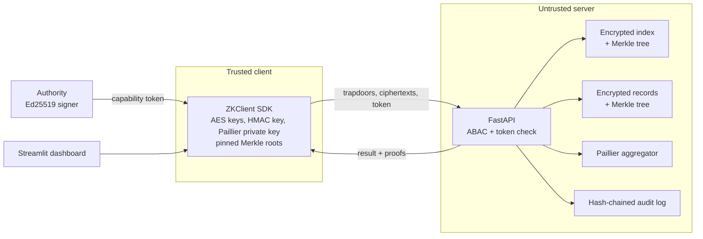

# Multi-Tenant Zero-Knowledge Cloud Engine

Information Security Lab mini project. An honest-but-curious cloud server stores encrypted multi-tenant records, answers keyword searches and computes sums over ciphertexts, and never sees plaintext, keys or search words. The system also attacks its own leakage, measures it, and verifies that the server did not lie.

"Zero-knowledge" here means the server learns nothing beyond the leakage profile below. No zero-knowledge proofs are used.

## What is different from a plain SSE + Paillier demo

| Area | Implementation |
|---|---|
| Real trust boundary | FastAPI server and a separate client SDK. The server holds only ciphertexts, trapdoors, Paillier public keys and Merkle trees. |
| Server-side ABAC | Ed25519-signed capability tokens carry the caller's attributes. The server verifies the signature, expiry and revocation, then runs the ABAC engine on every request and enforces per-record classification. |
| Leakage attack lab | A frequency/count attack on posting-list sizes, evaluated against each defense with measured recovery rates. |
| Defenses | Epoch-rotated trapdoors (unlinkable tokens across epochs) and decoy padding of posting lists to power-of-two sizes. |
| Verifiable results | Sparse Merkle trees over the index and the records. Every search result carries a membership or absence proof checked against a root pinned by the client. |
| Verified homomorphic sums | Weighted sums and averages over Paillier ciphertexts, with an optional audit that recomputes the result from proven ciphertexts. |
| Tamper-evident audit | Per-tenant hash-chained log of every decision. |

## Architecture



## Cryptographic design

| Component | Detail |
|---|---|
| Record encryption | AES-256-CBC, encrypt-then-MAC (HMAC-SHA256), keys derived with HKDF and bound to the tenant. |
| Trapdoor | `HMAC-SHA256(search_key, tenant ‖ epoch ‖ term)`. Terms are NFKC-normalised, case-folded and tokenised client-side. |
| Aggregation | Paillier, ciphertext product mod n². Weights use ciphertext exponentiation (`c^w`, negative weights via modular inverse). The result is re-randomised before return. Average = decrypted sum / count, computed at the client. |
| Capability token | `base64url(payload).base64url(Ed25519 signature)`. Payload: subject, tenant, role, department, clearance, `iat`, `exp`, `jti`. |
| Authenticated index | Sparse Merkle tree, depth 40, key = `SHA-256(trapdoor)[:5]`, bucketed leaves. Leaf value is the digest of the sorted posting list. Absence proofs are native. |
| Authenticated records | Same tree type, leaf value is the digest of `(id, payload, amount, department, classification)`. |
| Audit entry | `hash = SHA-256(prev_hash ‖ canonical_json(entry))`. |

## Protocols

**Bulk load.** Client encrypts records, builds postings per epoch (optionally padded with decoys), builds both trees locally, uploads, and rejects the server if its roots differ. Only the two roots are kept.

**Incremental add.** For the record and every affected token the client fetches a proof, verifies it against its pinned root, computes the new root from the same sibling path, uploads, and checks the server reports the same root.

**Search.** One trapdoor per epoch per term. The server returns the posting list and a proof. The client checks `digest(ids)` against the proven leaf (a dropped or added id fails), fetches the records with proofs, decrypts, and removes decoys by checking the term is really in the plaintext. AND/OR is combined at the client.

**Aggregate.** The client sends the exact id list it wants summed. The server rejects the whole request if any record is above the caller's clearance. The client decrypts the result. With audit on, it re-fetches the proven ciphertexts and compares; a forged sum raises `VerificationError`.

**Epoch rotation.** `rotate_epoch()` changes the trapdoor key schedule. Documents added afterwards cannot be linked to tokens the server has already seen. Cost: each search sends one trapdoor per epoch per term.

## Threat model and leakage

| Adversary | Covered |
|---|---|
| Honest-but-curious server | Sees only ciphertexts and the leakage below. |
| Malicious server | Dropped results, wrong index entries, swapped records and forged sums are detected (Merkle proofs and audit). |
| Forged, expired, replayed-after-revoke or cross-tenant caller | Rejected server-side. |
| Malicious client skipping UI checks | Irrelevant: all ABAC runs on the server. |

Still leaked to the server: record ids and sizes, `department` and `classification` (kept in plaintext for policy enforcement), access pattern (which ids match a trapdoor), search pattern within an epoch, padded posting-list sizes, and timing. A server that sees both the index and the records table can recognise decoys only by size correlation, not by identity.

## Measured attack results

`python -m src.attack` (2000 docs, 400-word Zipf vocabulary, top-40 words attacked, 5 trials). The attacker per epoch ranks tokens by posting size and matches them to an auxiliary frequency table. Random guessing scores about 0.25%.

| Defense | Top-40 recovery | Index size | Trapdoors per term query |
|---|---|---|---|
| none | 39.5% | 1.00x | 1 |
| padding | 11.5% | 1.39x | 1 |
| epochs = 4 | 31.8% | 1.00x | 4 |
| epochs = 8 | 24.8% | 1.00x | 8 |
| padding + epochs = 4 | 10.4% | 1.36x | 4 |
| padding + epochs = 8 | 10.1% | 1.32x | 8 |

Padding is the main defense against this attack. Epochs mainly give forward privacy and break cross-epoch linkage, with a smaller effect on this attack. Results are on synthetic data and a single attack family.

## Dashboard

Query (search, encrypted sum and average with verification status), client/server trace with the live audit chain and the server's stored view, leakage attack lab, malicious-server switches (drop result, forge sum, edit audit entry), and admin (add record, rotate epoch, revoke subject).

## API

| Method | Path | Action checked |
|---|---|---|
| POST | `/tenants/{t}` | admin |
| GET | `/t/{t}/roots` | read |
| POST | `/t/{t}/bulk` | index |
| GET, PUT | `/t/{t}/record/{id}/proof`, `/t/{t}/record/{id}` | index |
| GET, PUT | `/t/{t}/index/{trapdoor}/proof`, `/t/{t}/index/{trapdoor}` | index |
| POST | `/t/{t}/search` | search |
| POST | `/t/{t}/fetch` | read, plus classification per record |
| POST | `/t/{t}/aggregate` | aggregate, plus classification per record |
| GET | `/t/{t}/audit` | audit |
| POST | `/t/{t}/revoke` | admin |
| POST, GET | `/_demo/*` | only when `ZK_DEMO=1` |

## Project layout

| Path | Role |
|---|---|
| `src/crypto_engine.py` | AES-CBC + HMAC, HKDF, epoch trapdoors, Paillier wrapper |
| `src/homomorphic.py` | Ciphertext sum and weighted aggregation |
| `src/access_control.py` | ABAC engine |
| `src/capability.py` | Ed25519 authority, token issue and verify |
| `src/merkle.py` | Sparse Merkle tree, proofs, root updates from proofs |
| `src/protocol.py` | Shared digests |
| `src/server.py` | FastAPI server |
| `src/client.py` | Verifying client SDK |
| `src/audit.py` | Hash-chained audit log |
| `src/attack.py` | Synthetic corpus, count attack, defense comparison |
| `app.py` | Streamlit dashboard |
| `tests/` | Crypto, ABAC, Merkle, tokens, audit, end-to-end system tests |

## Run

```bash
pip install -r requirements.txt
streamlit run app.py
```

The dashboard starts the server automatically on `127.0.0.1:8000` with demo mode on and creates `.keys/authority.key`. To run the server yourself:

```bash
ZK_DEMO=1 uvicorn src.server:create_app_from_env --factory --port 8000
```

Use the same `ZK_AUTHORITY_KEY` path for the server and the dashboard, and set `ZK_SERVER_URL` for a remote server. Without `ZK_DEMO=1` the tamper and server-view endpoints do not exist.

```bash
python -m pytest
python -m src.attack
```

## Limitations

- Storage is in memory.
- One writer pins the roots. Multi-client root synchronisation is not implemented.
- Decoy padding is applied at bulk load only. Incremental adds are unpadded.
- The aggregate audit downloads the summed ciphertexts, so use a sampling rate below 1 for large sets.
- Search supports exact tokens with AND/OR. No ranking, prefix or fuzzy search.
- No TLS in the demo. Run behind HTTPS in any real deployment.
- Paillier supports sums and scalar weights only. Min, max and variance are out of scope.