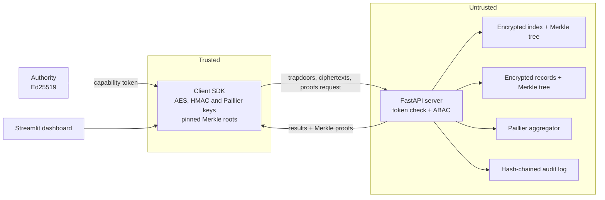

# Multi-Tenant Zero-Knowledge Cloud Engine


An untrusted cloud server that stores encrypted multi-tenant records, answers keyword searches and sums numbers over ciphertexts, without ever holding plaintext, keys or search words. The project also attacks its own searchable index, measures the leakage, and lets the client verify that the server did not lie.

Information Security Lab mini project, MAHE Manipal.

> "Zero-knowledge" here means the server learns nothing beyond the leakage listed below. No zero-knowledge proofs are used.

## Features

- **Blind keyword search** over an encrypted inverted index (HMAC-SHA256 trapdoors, AND/OR queries).
- **Encrypted analytics** with Paillier: sum, weighted sum and average computed on ciphertexts.
- **Server-side ABAC** driven by Ed25519-signed capability tokens (role, department, clearance, expiry, revocation) plus per-record classification checks.
- **Verifiable results**: sparse Merkle trees over the index and the records. Dropped results, swapped records and forged sums are rejected by the client.
- **Leakage attack lab**: a frequency/count attack on posting-list sizes, scored against two defenses (epoch-rotated trapdoors and decoy padding).
- **Tamper-evident audit log**: per-tenant hash chain of every access decision.
- **Live dashboard** with a client/server trace, the server's stored view, and switches that make the server malicious on demand.

## Architecture



| Piece | Detail |
|---|---|
| Record encryption | AES-256-CBC with HMAC-SHA256 (encrypt-then-MAC), HKDF-derived keys bound to the tenant |
| Trapdoor | `HMAC-SHA256(search_key, tenant, epoch, term)` |
| Aggregation | Paillier ciphertext product mod n², weights via exponentiation, result re-randomised |
| Auth | Ed25519 token with subject, tenant, role, department, clearance, `iat`, `exp` |
| Authenticated state | Sparse Merkle trees (depth 40) for the index and the records; the client keeps only the two roots |

## Quick start

Requires Python 3.11+.

```bash
git clone https://github.com/AayushCodes-28/Multi-tenant-zk-engine
cd Multi-tenant-zk-engine-main
pip install -r requirements.txt
streamlit run app.py
```

The dashboard starts the API server itself on `127.0.0.1:8000` in demo mode and creates `.keys/authority.key` on first run. In the sidebar, click **Register tenants and load demo data**, then use the tabs. A step-by-step walkthrough is in [DEMO.md](DEMO.md).

Run the server on its own:

```bash
ZK_DEMO=1 uvicorn src.server:create_app_from_env --factory --port 8000
```

| Variable | Default | Purpose |
|---|---|---|
| `ZK_DEMO` | `0` | Enables tamper switches and the server-view endpoint. Off in any real deployment. |
| `ZK_AUTHORITY_KEY` | `.keys/authority.key` | Authority key file, shared by server and token issuer |
| `ZK_SERVER_URL` | `http://127.0.0.1:8000` | Server address used by the dashboard |

## Using the SDK

```python
import httpx
from src.client import ZKClient
from src.crypto_engine import KeyMaterial

client = ZKClient(httpx.Client(base_url="http://127.0.0.1:8000"),
                  KeyMaterial.generate("acme-finance", paillier_bits=2048),
                  token=admin_token)

client.register({"department": "finance", "roles": ["analyst", "admin"], "writers": ["admin"]})
client.bulk_load(rows, pad=True)

result = client.search(["payroll", "quarterly"], mode="and")
total, count = client.aggregate_search("payroll")
client.rotate_epoch()
```

Tokens come from `Authority.issue(UserAttributes(...))` in `src/capability.py`. Every call that returns data raises `VerificationError` if a proof or the audited aggregate does not check out.

## Leakage and defenses

`python -m src.attack` runs a count attack: the server knows public word frequencies and matches posting-list sizes to keywords. Setup: 2000 documents, 400-word Zipf vocabulary, top 40 words attacked, 5 trials, attacker ranks tokens within each epoch. Random guessing is about 0.25%.

| Defense | Keywords recovered | Index size | Trapdoors per term |
|---|---|---|---|
| none | 39.5% | 1.00x | 1 |
| padding | 11.5% | 1.39x | 1 |
| epochs = 4 | 31.8% | 1.00x | 4 |
| epochs = 8 | 24.8% | 1.00x | 8 |
| padding + epochs = 4 | 10.4% | 1.36x | 4 |
| padding + epochs = 8 | 10.1% | 1.32x | 8 |

Padding does most of the work against this attack. Epoch rotation mainly provides forward privacy: documents added after a rotation cannot be linked to tokens the server has already seen. These numbers are from synthetic data and one attack family.

What the server still learns: record ids and sizes, `department` and `classification` (kept in plaintext so it can enforce policy), which ids match a token, repeated searches within an epoch, padded posting sizes and timing.

## Threat model

| Adversary | Outcome |
|---|---|
| Honest-but-curious server | Sees ciphertexts and the leakage above only |
| Malicious server | Dropped or altered results, wrong records and forged sums are detected by the client |
| Forged, expired, revoked or cross-tenant token | Rejected by the server |
| Client that skips UI checks | No effect, ABAC runs server-side |
| Network attacker | Out of scope, run behind TLS |

## API

| Method | Path | Checked action |
|---|---|---|
| POST | `/tenants/{t}` | admin |
| POST | `/t/{t}/bulk` | index |
| GET, PUT | `/t/{t}/record/{id}[/proof]`, `/t/{t}/index/{trapdoor}[/proof]` | index |
| POST | `/t/{t}/search` | search |
| POST | `/t/{t}/fetch` | read + record classification |
| POST | `/t/{t}/aggregate` | aggregate + record classification |
| GET | `/t/{t}/audit` | audit |
| POST | `/t/{t}/revoke` | admin |

## Project layout

```
app.py                  Streamlit dashboard
src/
  crypto_engine.py      AES-CBC + HMAC, HKDF, trapdoors, Paillier wrapper
  homomorphic.py        Ciphertext sum and weighted aggregation
  access_control.py     ABAC engine
  capability.py         Ed25519 authority and token verification
  merkle.py             Sparse Merkle tree and proofs
  protocol.py           Shared digests
  server.py             FastAPI server
  client.py             Verifying client SDK
  audit.py              Hash-chained audit log
  attack.py             Corpus generator, count attack, defense comparison
tests/                  Unit and end-to-end tests
data/sample_records.json  Demo records for two tenants
```

## Tests

```bash
python -m pytest
```

29 tests covering crypto, ABAC, Merkle proofs, tokens, the audit chain, and end-to-end flows against the real API (clearance enforcement, revocation, tamper detection, no plaintext on the server).

## Limitations

- Storage is in memory.
- One writer pins the Merkle roots. Multi-client root sync is not implemented.
- Decoy padding happens at bulk load only. Incremental adds are unpadded.
- The aggregate audit downloads the summed ciphertexts, so set `audit_rate` below 1 for large sets.
- Search is exact-token only, with AND/OR. No prefix, fuzzy or ranked search.
- Paillier gives sums and scalar weights only. No min, max or variance.
- No TLS in the demo.

## Team

| Name | Roll no. |
|---|---|
| Divyansh Garg | 12 |
| Upkirat Singh | 13 |
| Aayush Kumar Singh | 14 |

Guide: Abhishek A K

## License

MIT, see [LICENSE](LICENSE).